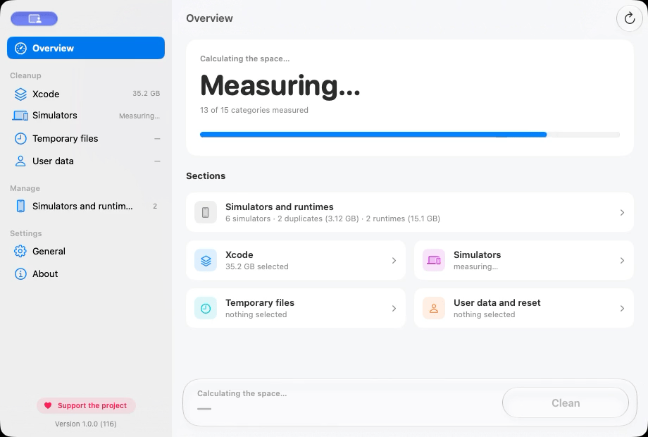

  

<h1 align="center">CleanerXcode</h1>

Free up the disk space Xcode keeps filling. Free, open source, and every donation goes to charity.

  
  
  
  

  

  

---

## What it does

- **See it first:** every item shows its size and its risk, and the Clean button shows the total before anything is removed.
- **Clean in one click:** DerivedData, caches, Archives, Device Support, simulator data, temporary files and more.
- **Stay safe:** risky items start off, ask for confirmation and go to the Trash. You can cancel at any time, and a report shows what was removed, skipped or failed, with Try Again.
- **Manage simulators and runtimes:** remove duplicate or old simulators, delete runtimes, and download the ones your Xcode needs.
- **Menu bar:** see the space you can free and start a cleanup without opening the window.

The [user guide](docs/USER_GUIDE.md) explains each item, its risk and what happens when it is removed.

---

## What's new in 1.0

- **A new window:** a sidebar with the Overview, a page for each section (Xcode, Simulators, Temporary files, User data), Simulators and runtimes, and Settings.
- **A native cleanup engine:** no shell scripts. Each item says its risk, and only safe items are on by default.
- **Download runtimes:** pick iOS, watchOS, tvOS or visionOS, choose an earlier version to test on older systems, and follow the progress and the time left.
- **Live size in the menu bar:** it updates a few seconds after a build or an archive changes the folders.
- **English and Brazilian Portuguese.**
- **Privacy first:** anonymous statistics that you can turn off, and crash reports without paths, names or exact sizes.

---

## Requirements

| macOS | Xcode | Price |
| --- | --- | --- |
| 26 or later | Any installed version | Free |

---

## Install

1. [Download CleanerXcode](https://github.com/didisouzacosta/CleanerXcode/raw/refs/heads/main/releases/CleanerXcode.dmg).
2. Open the DMG and drag CleanerXcode to Applications.

CleanerXcode checks GitHub for new versions and shows a button next to the version when one is available.

---

## Free, open source, for charity

- No ads, accounts or paid features.
- All the code is on GitHub under the [MIT license](LICENSE). Issues and pull requests are welcome; see [CONTRIBUTING.md](CONTRIBUTING.md).
- [Donations](https://buy.stripe.com/00gcN772R2ns3wA9AA) are optional, and 100% of the money goes to charities (shelters and hospitals).
- Only the analytics and crash-reporting keys stay out of the repository. A build without them works fully and sends nothing.

---

## Privacy

No sign-in and no personal data. Anonymous usage statistics (you can turn them off in Settings) and crash reports never include file paths, names or exact sizes. Details in [PRIVACY.md](docs/PRIVACY.md).

---

## Thanks

Dedicated to my son Orlando and my wife Gisele. Thanks to [Lesley](https://github.com/lesleyandrez) and [Nic](https://github.com/ngimelliUW) for all the help.
