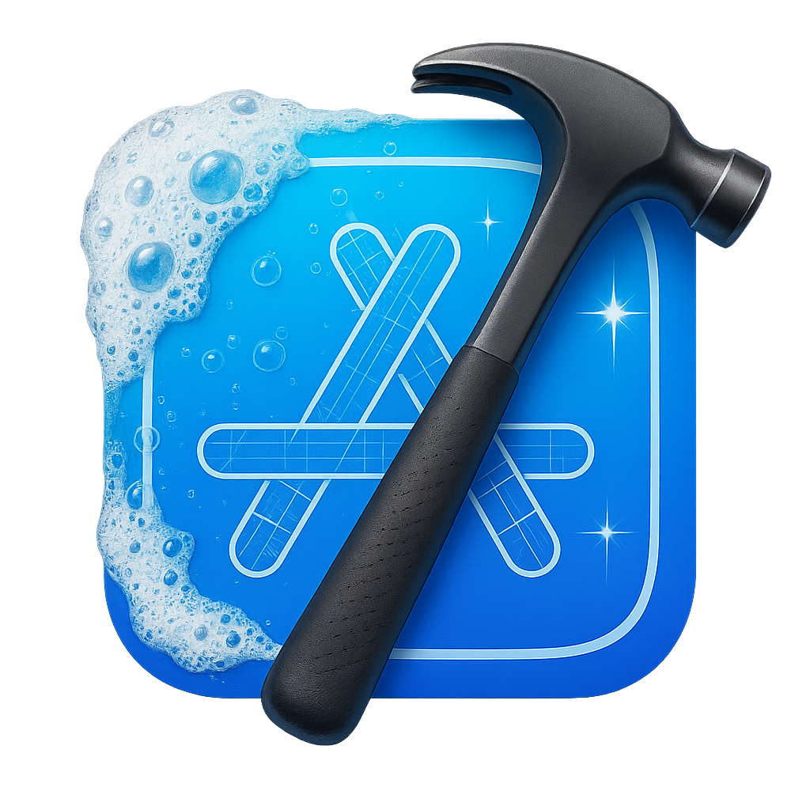

  

<h1 align="center">CleanerXcode</h1>

  Free up the disk space Xcode keeps filling. Free, open source, and every donation goes to charity.

  

<!-- Demo video: paste the GitHub video link (user-attachments) in the tag below and remove the placeholder line. -->

  <!-- <video src="VIDEO_URL"></video> -->
  <em>Demo video coming soon.</em>

## What it does

- **See it first:** each item shows how much space it takes, and the button shows the total before you clean.
- **Clean in one click:** Derived Data, caches, Archives, Device Support, simulator data, temporary files and more. Risky items are off by default, ask for confirmation, and go to the Trash.
- **Manage simulators and runtimes:** remove old or duplicate simulators, delete runtimes, and download new ones for the selected Xcode.
- **Stay in control:** a report shows what was removed, skipped or failed, with Try Again for the failures. You can cancel at any time.
- **Menu bar:** see the space you can free and start a cleanup from the menu bar.

The [user guide](docs/USER_GUIDE.md) explains each item, its risk and what happens when it is removed.

## Requirements

macOS 26 or later. Works with any installed Xcode.

## Free, open source, for charity

- CleanerXcode is free, with no ads, accounts or paid features.
- All the code is open on GitHub under the [MIT license](LICENSE). Issues and pull requests are welcome; see [CONTRIBUTING.md](CONTRIBUTING.md).
- [Donations](https://buy.stripe.com/00gcN772R2ns3wA9AA) are optional, and 100% of the money goes to charities (shelters and hospitals).
- The only private part is the analytics and crash-reporting keys, kept out of the repository. Builds without them work fully, with no data sent.

## Privacy

No sign-in and no personal data. Anonymous usage statistics (which you can turn off in Settings) and crash reports never include file paths, names or exact sizes. Details in [PRIVACY.md](docs/PRIVACY.md).

## Thanks

Dedicated to my son Orlando and my wife Gisele. Thanks to [Lesley](https://github.com/lesleyandrez) and [Nic](https://github.com/ngimelliUW) for all the help.
